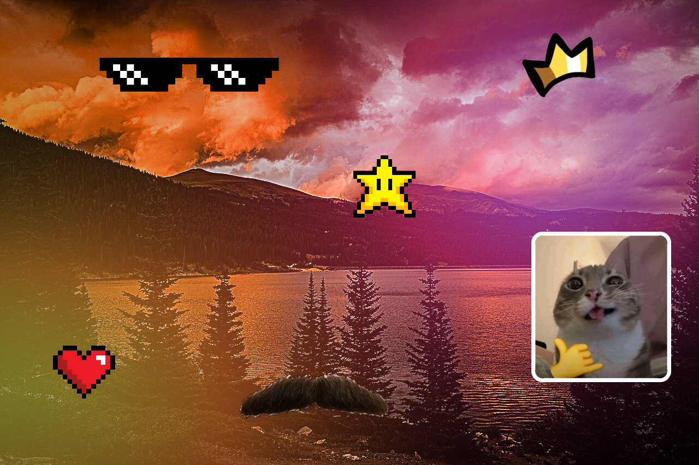
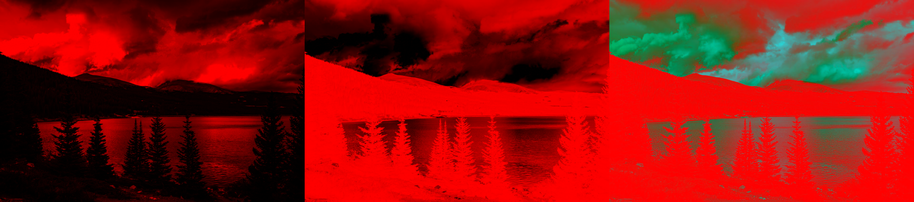

# InstagramStories: efeitos em imagens e vídeo

Protótipo de um aplicativo de edição de imagens e vídeo **inspirado nos stories do Instagram**,
feito em **Python + OpenCV** com interface gráfica em **Tkinter**. O foco é a aplicação de
técnicas de processamento de imagens filtros espaciais (suavização, realce, morfologia),
transformações de intensidade e cor, operações aritméticas entre imagens, composição com
canal alfa (stickers) e detecção de face.

Aluno: Joao Pedro Araújo Rocha



## Como executar

```bash
pip install -r requirements.txt
python main.py
```

Opções de linha de comando:

```bash
python main.py assets/imagens/por_do_sol_lago.jpg    # abre já com uma foto
python main.py --webcam                              # inicia a webcam 0 (ou --webcam 1)
python main.py --video caminho/do/video.mp4          # modo vídeo a partir de um arquivo
```

## Requisitos do trabalho e onde estão atendidos

| Requisito | Implementação |
|---|---|
| Modo Foto (carregar imagem do disco) | Botão **Abrir foto** (Ctrl+O) |
| Modo Vídeo (webcam em tempo real) | Botão **Iniciar/Parar webcam** (Ctrl+W), com captura em thread |
| Filtro de suavização | Média, Gaussiano, Mediana, Bilateral, Desfoque de movimento |
| Filtro de realce | Nitidez, Unsharp Mask, Laplaciano, Sobel, Canny, Relevo |
| Seleção de canal (RGB/Cinza/R/G/B) | Painel **Canal**: o filtro atua só no canal escolhido e a tela mostra aquele canal |
| 3 operações com duas imagens | **5 operações**: adição, subtração ponderada, blending, diferença absoluta e tela (screen) |
| Descrição antes de aplicar | Ao selecionar um filtro ou operação, a descrição e os parâmetros aparecem **na interface e no console** |
| 5 stickers com alfa, posicionados com o mouse | **9 stickers** (7 imagens baixadas + 2 animações); clique para colocar, arraste para mover |
| Salvar | **Salvar** (Ctrl+S) ou salvar rápido em `saidas/` (Ctrl+Shift+S); no vídeo, salva o frame atual |
| Resetar | **Resetar** (Ctrl+R) volta à imagem original; **Desfazer** (Ctrl+Z) volta um passo |
| *Extra:* interface gráfica | Tkinter, com prévia ao vivo e sliders de parâmetros |
| *Extra:* combinação de filtros | Pipeline de etapas: cada filtro é aplicado sobre o resultado do anterior |
| *Extra:* stickers animados | Spritesheets (coração pulsante e estrela saltitante), quadro escolhido por `int(t·fps) % nQuadros` |
| *Extra:* detecção de face | Filtros de rosto (Thug Life, coroa, bigode, corações, estrela, beauty, pixelar, retrato) |

## Como usar

1. **Abra uma foto** ou **inicie a webcam**. Também é possível abrir um arquivo de vídeo pelo
   painel esquerdo. A webcam é escolhida na lista **Câmera** do painel VÍDEO, que mostra as
   câmeras conectadas pelo nome. Ao parar o vídeo, o programa volta para a tela inicial.
2. **Aba Filtros**: selecione um filtro. A descrição e os parâmetros aparecem, junto com a
   **prévia** na imagem. Ajuste os sliders e clique em **Aplicar filtro** (ou Enter). Os
   filtros aplicados entram na lista **Etapas aplicadas** e se acumulam.
3. **Canal**: com `R`, `G` ou `B`, o filtro atua só naquele canal (os outros ficam intactos) e
   a imagem principal mostra o canal (colorido ou em tons de cinza). `Cinza` converte para
   tons de cinza antes de filtrar.

   

   *Da esquerda para a direita: canal R original, canal R depois do Negativo aplicado só em R,
   e a imagem em RGB (G e B ficaram intactos).*
4. **Aba Operações**: escolha a imagem B (arquivo, textura gerada ou a própria imagem atual),
   selecione a operação e aplique. No modo vídeo, **Usar imagem atual** + **Diferença
   absoluta** vira um detector de movimento.
5. **Aba Stickers & Rosto**: escolha um sticker e clique na imagem. Arraste para mover, use
   o botão direito para remover, a roda do mouse para mudar o tamanho e Shift+roda para girar.
   Em **Filtros de rosto**, os stickers são posicionados automaticamente nos rostos detectados
   (na foto e na webcam).
6. **Salvar** grava exatamente o que está na tela (filtros, canal e stickers).

### Filtros

| Categoria | Filtros |
|---|---|
| Suavização (passa-baixa) | Média (Box), Gaussiano, Mediana, Bilateral, Desfoque de movimento |
| Realce e bordas (passa-alta) | Nitidez (Sharpen), Unsharp Mask, Laplaciano (bordas ou realce `f − c·∇²f`), Sobel (dx/dy/magnitude), Canny/Neon, Relevo (Emboss) |
| Estatísticos/morfológicos | Máximo (Dilatação), Mínimo (Erosão), Gradiente morfológico |
| Cor e intensidade | Escala de cinza (luminância ou média), Negativo (XOR 255), Sépia, Brilho/Contraste, Correção gama (LUT), Binarização (fixa/Otsu/adaptativa), Saturação e matiz (HSV), Equalização (CLAHE/global), Temperatura de cor, Posterização |
| Efeitos e estilos | Vinheta, Pixelizar, Cartoon, Ruído (sal e pimenta/gaussiano), Vintage |

Cada filtro tem uma descrição e parâmetros configuráveis (tamanho de kernel ímpar, sigma,
limiares, intensidade etc.). Veja `instagram_stories/filtros.py`.

### Operações entre duas imagens

Adição `A + k·B`, Subtração ponderada `α·A − β·B + γ`, Blending `α·A + (1−α)·B`, Diferença
absoluta `|A − B|` e Tela (Screen) `255 − (255−A)(255−B)/255`. A imagem B é
redimensionada para cobrir A e recortada no centro, sem distorcer. Há texturas geradas para
usar como B: gradientes, *light leak*, bokeh, vinheta, grão de filme e xadrez.

### Detecção de face

O detector é escolhido automaticamente:

- **YuNet** (`cv2.FaceDetectorYN`): o modelo `face_detection_yunet_2023mar.onnx` (~230 KB,
  do [opencv_zoo](https://github.com/opencv/opencv_zoo/tree/main/models/face_detection_yunet))
  já está em `assets/modelos/`. Ele devolve os olhos, o nariz e a boca, e os stickers giram
  junto com a cabeça.
- **Haar Cascade** (`cv2.CascadeClassifier`): usado automaticamente com o opencv-python 4.x,
  que já traz `haarcascade_frontalface_default.xml`. Os pontos do rosto são estimados pelas
  proporções do retângulo.

## Detalhes de implementação

- **Canais**: `aplicar_por_canal()` separa o canal (ou converte para cinza), aplica a função e
  recompõe a imagem BGR. `visualizar_canal()` gera a imagem exibida para R, G ou B.
- **Pipeline** (`pipeline.py`): lista de etapas `Etapa(filtro|operação, parâmetros, canal)`. No
  modo foto, o resultado acumulado fica em cache, então só a nova etapa é calculada; no vídeo,
  a sequência é aplicada a cada frame.
- **Stickers** (`stickers.py`): composição alfa `C = c_sticker·α + c_fundo·(1 − α)`, com
  recorte nas bordas, escala e rotação (`warpAffine`). A posição é relativa (0–1), então o
  sticker fica no lugar certo em qualquer resolução.
- **Webcam** (`webcam.py`): uma thread lê os frames e a interface processa sempre o mais recente.
- **Lista de câmeras** (`cameras.py`): o OpenCV abre a câmera pelo número, mas não informa o nome.
  No Windows, os nomes são lidos da lista de dispositivos de vídeo do DirectShow (API COM, via
  `ctypes`), que tem a mesma ordem dos números usados pelo `cv2.CAP_DSHOW`. Em outros sistemas,
  os números de 0 a 3 são testados com o OpenCV.
- **Visual**: a interface e as mensagens do terminal usam um tema azul-escuro inspirado no
  TeamSpeak 6 (azul `#2580c3`). No terminal, as cores usam códigos ANSI de 24 bits e são
  desligadas quando a saída é redirecionada ou quando a variável `NO_COLOR` existe.
- **Caminhos com acento** (ex.: "Processamento Gráfico"): `cv2.imread`/`imwrite` falham no
  Windows com esses caminhos, por isso a leitura e a gravação usam `np.fromfile` + `cv2.imdecode`
  e `cv2.imencode` + `tofile`.

## Estrutura

```
InstagramStories/
├── main.py                   # ponto de entrada
├── instagram_stories/
│   ├── filtros.py            # filtros + seleção de canal
│   ├── operacoes.py          # 5 operações com 2 imagens + texturas
│   ├── pipeline.py           # combinação de filtros (etapas)
│   ├── stickers.py           # stickers com alfa / spritesheets
│   ├── rosto.py              # detecção de face + filtros de rosto
│   ├── webcam.py             # captura de vídeo em thread
│   ├── cameras.py            # lista as câmeras conectadas (com o nome)
│   ├── io_utils.py           # leitura/gravação (caminhos com acento)
│   ├── console.py            # mensagens em azul no terminal
│   └── gui.py                # interface Tkinter
├── assets/
│   ├── stickers/             # PNGs com alfa (prontos) + stickers.json
│   ├── imagens/              # fotos para testar (lago, praia, pôr do sol)
│   └── modelos/              # modelo YuNet (detecção de face)
├── docs/                     # capturas de tela usadas neste README
└── saidas/                   # imagens salvas pelo programa
```

## Imagens e créditos

**Stickers:** óculos Thug Life, estrela, coroa, coração, bigode, a foto
do gato e a foto do filhote de leopardo baixados da internet. Os arquivos em
`assets/stickers/` já estão prontos, em PNG com transparência (canal alfa): o fundo das imagens
originais foi removido (no leopardo, o fundo desfocado foi separado com o GrabCut do OpenCV) e
as animações do coração pulsante e da estrela saltitante foram montadas como spritesheets de 8
quadros a partir dos próprios desenhos.

Para adicionar um sticker novo, coloque um PNG com fundo transparente em `assets/stickers/` e
acrescente uma linha em `stickers.json` com `id`, `nome` e `arquivo`. Use `"pixel_art": true`
para ampliar sem borrar.

| Imagem | Fonte | Licença |
|---|---|---|
| Stickers em `assets/stickers/` | baixados pelo autor do trabalho (*preencher os sites de origem*) | verificar em cada site |
| `assets/imagens/praia_caverna.jpg` e `assets/imagens/lago_floresta.jpg` | baixadas pelo autor do trabalho (*preencher os sites de origem*) | verificar em cada site |
| `assets/imagens/por_do_sol_lago.jpg` | [Mountain Lake Sunset](https://commons.wikimedia.org/wiki/File:Mountain_Lake_Sunset.jpg), 420 Photography (Wikimedia Commons) | [CC0 1.0](https://creativecommons.org/publicdomain/zero/1.0/) (domínio público) |
| `assets/modelos/face_detection_yunet_2023mar.onnx` | [opencv_zoo](https://github.com/opencv/opencv_zoo/tree/main/models/face_detection_yunet) | MIT |

## Referências

- GONZALEZ, R. C.; WOODS, R. E. *Digital Image Processing*. 4. ed. Pearson, 2018.
- Documentação oficial do OpenCV: <https://docs.opencv.org/4.x/>
- Slides da disciplina de Processamento Gráfico (Unisinos, R. B. Queiroz): *Filtros - OpenCV*,
  *Processamento de Imagens*, *Sistemas de Cores & Introdução ao Processamento de Imagens* e
  *Camadas e Sprites*.
- YuNet: <https://github.com/opencv/opencv_zoo/tree/main/models/face_detection_yunet>
